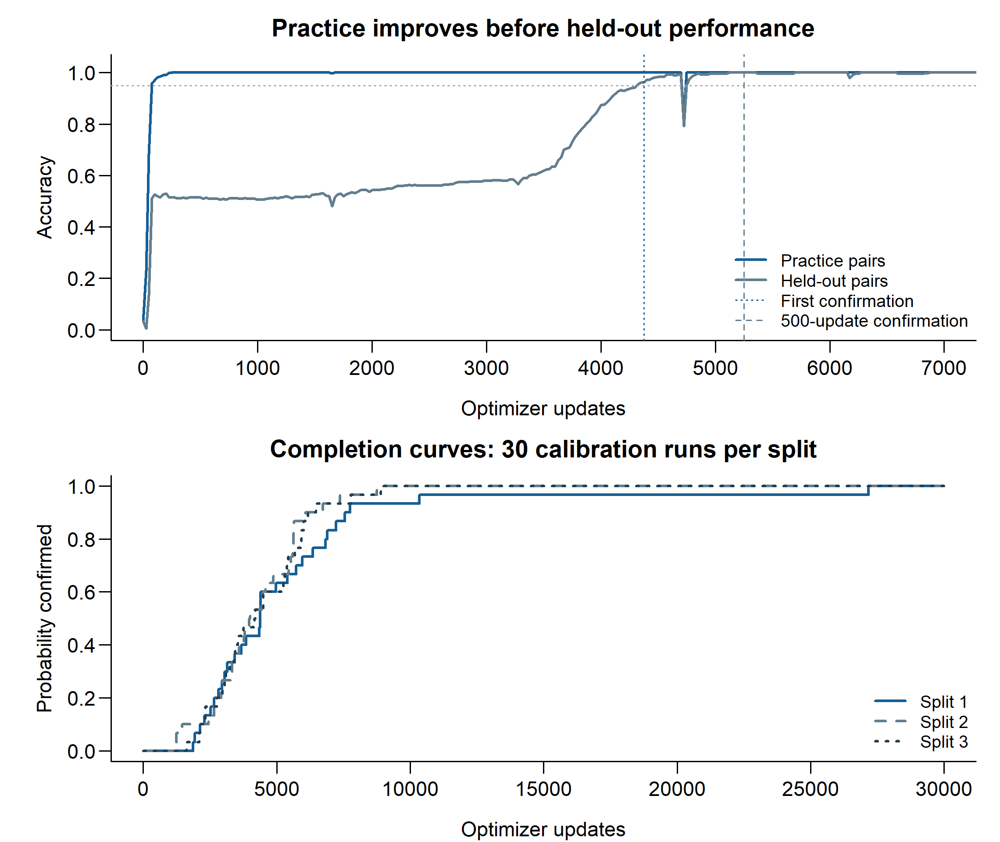

# Grokking under a fixed budget

**Question:** with the same total number of training steps, is one long run more likely to generalize than several independent shorter runs?

This public research snapshot contains the implementation, recorded experiments, statistical analysis and submission materials for a BAMAT207 Probability and Statistics project. The dataset is generated in Python: all 961 ordered pairs for `(a + b) mod 31`.

## Submission files

| Assessment | File |
|---|---|
| 9 — IEEE report | [Six-page report](output/assessments_visual/Assessment9_IEEE_Visual_Report.pdf) |
| 10 — presentation | [Editable PowerPoint](output/assessments_visual/Assessment10_Visual.pptx) · [PDF](output/assessments_visual/Assessment10_Visual.pdf) |
| 10 — short explanation | [Two-page visual document](output/assessments_visual/Assessment10_Visual_Explanation.pdf) |
| Full study | [Eight-page paper](output/paper_v2/paper.pdf) · [Technical supplement](output/paper_v2/supplement.pdf) |
| Submission form | [Copy-ready entries](SUBMISSION.md) |

Team: **Vihaan Jinesh Jain (25BYB0103)**, **Kaashvi Goel (25BYB0129)** and **Gaurav Kansal (25BYB0157)**. Author fields remain editable. Course submission and plagiarism clearance are separate from completion of the experiments.

## Result

Successes out of **30 independent budget attempts** in every cell:

| Split | Total updates | One run | Two runs | Four runs |
|---|---:|---:|---:|---:|
| S1 | 8,000 | 28 | 23 | 12 |
| S2 | 8,000 | 28 | 24 | 9 |
| S3 | 8,000 | 28 | 25 | 11 |
| S1 | 12,000 | 30 | 30 | 24 |
| S2 | 12,000 | 30 | 30 | 20 |
| S3 | 12,000 | 30 | 29 | 23 |

At 8,000 updates, one long run was more reliable than four shorter runs across all three splits after the planned Holm correction. Two-run comparisons were inconclusive. These results apply to this task, model and three fixed partitions, not every learning problem.

## From code to results

| Where to look | Contents |
|---|---|
| [Code walkthrough](paper/v2/CODE_WALKTHROUGH.md) | Plain explanations of the backend |
| [Python source](grokking/) | Dataset, transformer, training, checkpoints and audits |
| [Dataset CSV](data/dataset/modular_addition_31.csv) | All 961 labelled pairs and four recorded partition settings |
| [R analysis](analysis/paper_v2.R) | Intervals, comparisons, regression and figure generation |
| [Fixed design](configs/paper_study.json) · [Protocol](docs/PAPER_V2_PROTOCOL.md) | Budgets, seeds, thresholds and phase ordering |
| [Original data](data/runs/) · [Follow-up data](data/paper_v2/runs/) | Raw accuracy traces, actual configurations and summaries |
| [Attempt outcomes](data/paper_v2/attempt_summary.csv) | All 540 fresh policy attempts |
| [Statistics and figures](output/paper_v2/) | CSV tables and high-resolution PNG/vector PDF graphs |
| [Syllabus mapping](docs/SYLLABUS_MAP.md) | Probability/statistics concepts used |
| [Reproduction](REPRODUCTION.md) | Verify the evidence and regenerate results |
| [Attribution and assistance](ACKNOWLEDGEMENTS.md) | Established methods and assistance used |

The follow-up has 90 calibration observations (20 reused), 540 fresh validation attempts, 1,330 new training runs and 7.5 million logical updates. The earlier 120-run setting study remains available as supporting exploratory evidence. Unfinished learning times remain unknown; capped times are identified separately.

This is a public snapshot released on 22 October 2026, not a claim that its initial public commit predates the experiments. Original delivery records are retained; [provenance](PROVENANCE.md) explains their scope. No dashboard or model-serving deployment is required.
