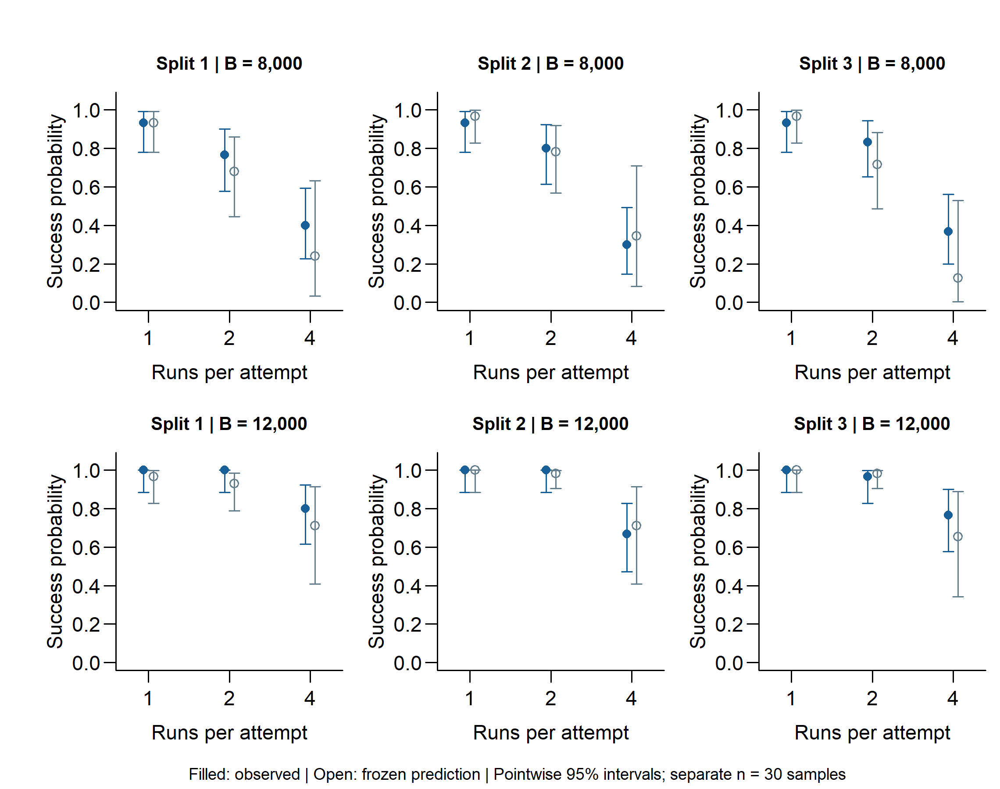
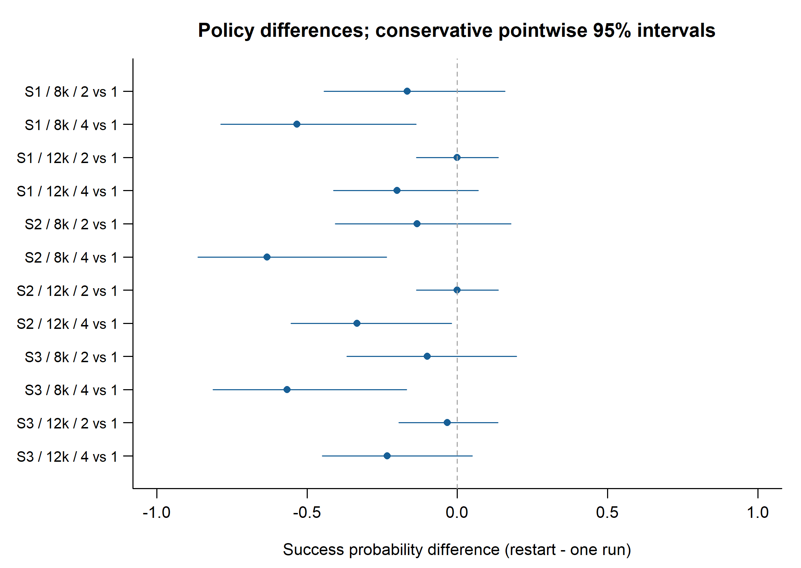
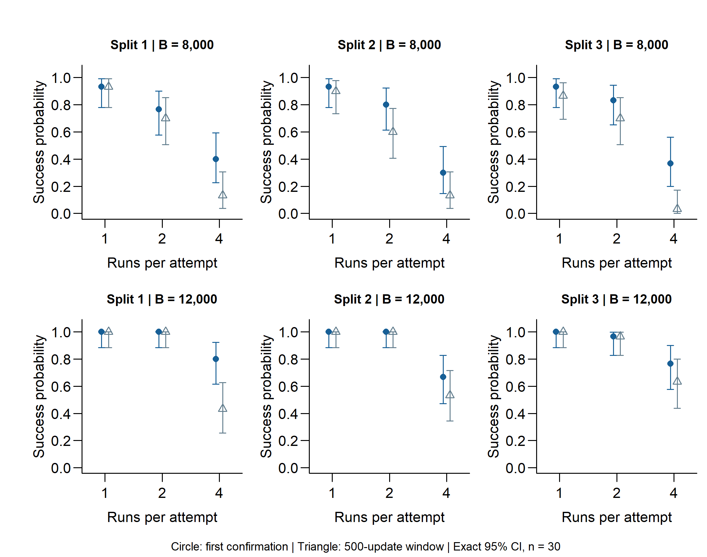

# Grokking Under a Fixed Budget: An Empirical Study of Learning Time and Independent Restarts

<!-- style: CaptionPaper -->

BAMAT207 Probability and Statistics | Follow-up protocol specified 15 October 2026 Name: [Your name] | Registration number: [Your registration number]

## Abstract

Grokking describes delayed improvement on unseen examples after a model fits its training examples. We study time to confirmed generalization in a small transformer learning addition modulo 31. An original 120-run setting study is extended with 90 calibration observations across three fixed dataset splits, including 20 reused observations, and 540 fresh policy attempts. One, two or four independent runs share total budgets of 8,000 or 12,000 updates. First confirmation requires three qualifying evaluations; a secondary endpoint requires a 500-update accuracy window. On the original split at 8,000 updates, observed first-confirmation success is 28/30, 23/30, 12/30 for the three policies. Four restarts underperform one long run at 8,000 updates on all three splits after Holm correction. At 12,000, only one of the three four-run contrasts is detected; no two-run contrast is detected. In total, 4 of twelve pre-specified contrasts pass adjusted testing at 0.05. Exact intervals are reported separately for every split. The design estimates budget-dependent reliability without treating unfinished times as known completions or inferring equivalence from nonsignificance. The proposed contribution is a reproducible empirical comparison, conditional on this task, architecture and numerical environment.

## 1. Introduction and objectives

A model can answer its practice questions correctly while still failing on questions excluded from training. Delayed improvement on the latter is the pattern called grokking [1]. A single successful trajectory cannot describe how often that pattern occurs or how long another random start might take. Our objectives are to characterize this variation, estimate success within a finite budget, and test the predictions obtained when that budget is divided among independent starts.

## 2. Related work and contribution

Power et al. established the grokking phenomenon [1]. Truong et al. study prediction of the delay as a first-passage problem [2], while restart schedules have an established randomized-algorithm literature [3]. Ootani emphasizes repeated seeds and a controlled numerical environment [4]. Our contribution is the measured connection between completion-time variability, equal-update allocation and a finite stability check. We do not introduce the restart identity or establish worldwide novelty.

---

## 3. Experimental design

Generate all 961 ordered pairs a,b in {0,...,30}, with label (a+b) mod 31. For example, (30+4) mod 31=3. The baseline uses 576 practice pairs and 385 held-out pairs. The network is a fixed causal transformer with 36,992 trainable parameters [6]: one attention block, embedding width 64, four heads and a 128-unit ReLU feed-forward layer, without biases, dropout or layer normalization. Full-batch AdamW [5] uses learning rate 0.003, betas (0.9,0.98) and weight decay 1. The supplementary setting study varies decay and data fraction; architecture and numerical rules remain fixed.

<!-- table-widths: 1.45,2.55,2.65 -->

| Cohort | Purpose | Sample |
| --- | --- | --- |
| Original main study | Exploratory setting comparisons | 120 runs; 20 per six cells |
| Follow-up calibration | Completion curves for three fixed splits | 90 runs; 20 reused + 70 new |
| Follow-up validation | Fresh equal-budget comparisons | 540 attempts; 1,260 runs |

Split seeds are 20261013, 20261014 and 20261015. Each has 30 calibration runs to C=30,000 updates. Fresh validation uses 30 attempts per split/budget/policy, with k=1,2,4 constituent runs receiving B/k updates each. Seeds are disjoint between calibration and validation. All allocated updates execute, even if success occurs early. This is an at-least-one-success policy, not prediction averaging across models.

## 3.1 Outcomes and prospective controls

An update is one learning step; accuracy is the fraction of correct answers. Evaluate every 25 updates, excluding update zero from streaks. T records the third consecutive check with practice accuracy at least 99% and held-out accuracy at least 95%. Memorization time M uses three checks with at least 99% practice accuracy; T itself need not be delayed. T_500 records the 21st consecutive qualifying check, spanning 500 updates. Both are final confirmation times, not the beginning of a streak. T_500 measures finite-window stability, not permanent learning.

The budgets were chosen using the original 20 baseline traces, after all old policies succeeded 10/10 at 30,000 updates. That data-informed choice is disclosed. The follow-up protocol and full seed manifest were committed before training; all calibration predictions were frozen before validation. Budgets, settings and sample sizes were not retuned to produce a preferred result. The original delivery remains archived separately.

## 3.2 Execution

Training uses CPU, four threads per run, float32, deterministic algorithms and disabled TF32, with no more than three independent processes. CUDA was unavailable in the recorded environment. Checkpoint recovery may repeat unsaved physical work; elapsed time excludes downtime and is affected by scheduling contention. Equality refers to logical optimizer updates within the same setting, not wall-clock speed or physical recovery overhead.

Recorded per-run elapsed times sum to 4.24 run-hours for new calibration and 8.60 for validation. Parallel jobs overlap, so these sums are not wall-clock duration. Unsaved work before interruption is not fully measured.

---

## 4. Learning-time variability

Across the 90 calibration observations, 90 first confirmations and 90 500-update confirmations occur by C. On the original split, mean capped first-confirmation time U is 5,347 updates, median 4,375 and sample SD 4,610. The means describe U=min(T,C); an unfinished T remains unknown. Calibration extends only the baseline setting, not all six original experimental cells.

<!-- figure-width: 6.65 -->

<!-- style: CaptionPaper -->

Figure 1. Top: an original-split calibration run selected closest to median T, with first confirmation at 4,375 updates. The early window is illustrative; the full trace is retained. Bottom: empirical first-confirmation curves for all three splits, each with 30 calibration observations through 30,000 updates and unfinished outcomes retained in its denominator. Split 1 includes 20 reused runs; the other 70 calibration observations are new.

Each curve is the fraction of its 30 runs confirmed by time t. Unfinished runs remain in the denominator. Differences are conditional on these fixed partitions, not all possible tasks.

<!-- table-widths: 0.65,1.15,1.65,1.6,1.6 -->

| Split | First events | 500-window events | Mean U | Median U |
| --- | --- | --- | --- | --- |
| S1 | 30/30 | 30/30 | 5,347 | 4,375 |
| S2 | 30/30 | 30/30 | 4,251 | 3,988 |
| S3 | 30/30 | 30/30 | 4,378 | 4,188 |

---

## 5. Budget reliability: prediction and validation

For k independent runs, each receiving B/k updates, the chance all fail is [1-F(B/k)]^k. Thus P(at least one succeeds)=1-[1-F(B/k)]^k. We estimate F from the separate calibration sample; validation uses fresh seeds. Exact binomial intervals accompany observed proportions. Independent bootstrap resampling of calibration runs and policy attempts captures both sources of uncertainty when comparing prediction with observation.

<!-- figure-width: 6.65 -->

<!-- style: CaptionPaper -->

Figure 2. Filled points show observed first-confirmation proportions with exact 95% binomial intervals (30 fresh attempts per policy). Open points show frozen predictions with the transformed exact calibration intervals (30 separate calibration runs per split). All intervals are pointwise. S1 includes 20 reused calibration runs; its prediction intervals do not adjust for the earlier budget choice. All six conditions are reported, including unfavourable or inconclusive outcomes.

Three splits are fixed replications, not three new tasks. We interpret each panel separately. Point estimates near one can still have substantial uncertainty at n=30. Agreement with a prediction is not proof of the full timing model, and a nonsignificant contrast is not evidence that policies are equivalent.

---

## 5.1 Pre-specified policy comparisons

Twelve two-sided Fisher exact tests compare k=2 or k=4 with k=1 within each budget and split. Each null hypothesis states that the success probabilities are equal. Holm correction is applied jointly across all twelve; 4 adjusted p-values are below 0.05. The risk difference is restart probability minus the one-run probability. Negative values favour the one-run policy; positive values favour the specified restart policy. Figure 3 uses conservative pointwise intervals from exact binomial margins. Planned bootstrap intervals remain in the numerical output as sensitivity summaries. Table differences are in percentage points (pp).

<!-- figure-width: 6.3 -->

<!-- style: CaptionPaper -->

Figure 3. First-confirmation probability differences. S1-S3 identify the fixed splits. Bounds combine two exact 97.5% marginal intervals to give conservative pointwise 95% coverage for a difference; they are not simultaneous across all contrasts. This avoids a collapsed bootstrap interval in constant-outcome groups. The zero line denotes equal probabilities.

<!-- table-widths: 1.15,1.65,1.65,2.2 -->

| Split / B | 2 runs minus 1 | 4 runs minus 1 | Holm p: 2 / 4 |
| --- | --- | --- | --- |
| S1 / 8k | -16.7 pp | -53.3 pp | 0.873 / 0.000187 |
| S1 / 12k | +0.0 pp | -20.0 pp | 1 / 0.166 |
| S2 / 8k | -13.3 pp | -63.3 pp | 1 / 6.57e-06 |
| S2 / 12k | +0.0 pp | -33.3 pp | 1 / 0.00717 |
| S3 / 8k | -10.0 pp | -56.7 pp | 1 / 6.8e-05 |
| S3 / 12k | -3.3 pp | -23.3 pp | 1 / 0.0843 |

---

## 6. First confirmation versus 500-update stability

The primary rule confirms three checks separated by 25 updates. It does not require later accuracy to remain high. In the original 120-run study, 62 of 83 generalized runs later fell below 95% held-out accuracy. The follow-up therefore derives a distinct endpoint requiring 21 qualifying checks, spanning 500 updates, from exactly the same traces.

<!-- figure-width: 6.65 -->

<!-- style: CaptionPaper -->

Figure 4. Both endpoints use the same attempt and must finish within its constituent cap B/k; panels use total B=8,000 or 12,000. Circles denote first confirmation and triangles the 500-update window. Bars are exact 95% intervals. The two endpoints are correlated, not independent samples.

A stability event must finish before the constituent cap; no extra follow-up is granted to a short run. The stability event implies the primary event, so its probability cannot exceed primary success in the same sample. These secondary comparisons are descriptive. They distinguish a brief confirmation from a longer accuracy window, while allowing further deterioration after either event. Neither endpoint establishes permanent generalization or human-like rule understanding.

---

## 7. Supporting setting comparisons and timing models

The original study retains 20 runs in each of six data-fraction/weight-decay cells. Its results provide exploratory context rather than additional validation attempts. The all-unfinished cell has U=C in every sample; zero sample SD of U does not imply zero variability in unrestricted T. Mean comparisons, regression and ANOVA describe capped outcomes only.

<!-- table-widths: 1.3,0.8,1.2,1.7,1.65 -->

| Data fraction | Decay | Events / n | Mean U | SD U |
| --- | --- | --- | --- | --- |
| 0.4 | 0.3 | 0/20 | 30,000 | 0 |
| 0.6 | 0.3 | 19/20 | 15,235 | 7,786 |
| 0.4 | 1 | 14/20 | 19,822 | 8,562 |
| 0.6 | 1 | 20/20 | 5,481 | 5,548 |
| 0.4 | 3 | 10/20 | 20,282 | 11,447 |
| 0.6 | 3 | 20/20 | 1,430 | 1,164 |

At 60% data, Pearson correlation of U with log decay is -0.715 and Spearman correlation is -0.866. The original two-factor residual Shapiro-Wilk p=0.000199 cautions against normal-error ANOVA claims. Permutation sensitivity also assumes exchangeable errors. The additive regression R-squared=0.630 describes sample variation, not held-out prediction accuracy. These syllabus analyses remain exploratory.

## 7.1 Candidate distributions

The expanded original-split calibration sample fits Exponential, Gamma and Weibull timing families. The recording-grid likelihood assigns event mass G(t-50)-G(t-75) to T=t and survival 1-G(C-50) to an unfinished run. AIC balances fit and parameter count; among converged fits, Gamma ranks lowest here (AIC 372.13). This is candidate ranking, not proof of a true timing law. Fitted curves are supplied separately; policy predictions use empirical F, not these timing fits.

<!-- table-widths: 2.1,1.35,1.35,1.85 -->

| Candidate | Events / n | AIC | Converged |
| --- | --- | --- | --- |
| Exponential | 30/30 | 383.22 | TRUE |
| Gamma | 30/30 | 372.13 | TRUE |
| Weibull | 30/30 | 378.13 | TRUE |

The project applies random variables, capped expectation and variability, Bernoulli/binomial outcomes, intervals, hypothesis comparisons, regression and ANOVA where justified by the supplied syllabus [7]. It does not force a variance test or goodness-of-fit test onto unsuitable capped samples.

---

## 8. Discussion and limitations

At 8,000 updates, one long run succeeds in 28/30 attempts on every split; four restarts succeed in 12/30, 9/30 and 11/30. All three contrasts survive Holm correction. At 12,000 updates, one run succeeds in 30/30 on every split, versus 24/30, 20/30 and 23/30 for four restarts; only the second-split contrast survives correction. No two-run contrast is detected. Dividing the budget too finely leaves less time for each learning delay. This interpretation is conditional on the measured curves, rather than a general argument against restarts. The earlier 30,000-update ceiling result remains consistent with these smaller-budget differences.

Evidence is conditional on one arithmetic task, one small architecture, selected decay and three fixed splits. Thirty attempts per condition are useful for substantial differences but cannot reliably resolve tiny gaps or establish equivalence. Held-out pairs are excluded from gradient updates but monitored for the endpoint; no additional untouched test set is claimed. Calibration predictions across budgets are correlated, and S1 intervals do not adjust for budget selection using reused traces. Bootstrap intervals are pointwise; normal-error assumptions fail in the exploratory setting models. Three split replications do not establish transfer to larger networks, natural-language tasks or different numerical environments.

## 9. Conclusion

For this model and these three splits, four short runs are less reliable than one long run at 8,000 total updates. The 12,000-update results leave several comparisons unresolved; nonsignificance does not establish equality. Completion curves make budget allocation testable, while the 500-update endpoint shows why brief confirmation needs a separate stability description. Future work can test other tasks, additional splits and longer windows. No universal restart rule or new timing theorem is established.

## Data availability and contribution

The versioned project repository retains source, fixed configuration, complete seed manifest, raw evaluation traces, R tables and graph sources, plus reproduction and audit commands. Repository access is controlled by its owner. Local checkpoints and dependency runtimes are excluded from Git. New training records, figures and manuscripts are separate from the archived original delivery. Established grokking and restart ideas are attributed; worldwide novelty and institutional similarity clearance are not claimed.

## References

<!-- style: CaptionPaper -->

[1] Power et al. (2022). <i>Grokking: Generalization Beyond Overfitting on Small Algorithmic Datasets</i>. Preprint. https://arxiv.org/abs/2201.02177

<!-- style: CaptionPaper -->

[2] Truong et al. (2026). <i>First-Passage Prediction of Grokking Delay: A Calibrated Law under AdamW with Causal Validation</i>. Preprint. https://arxiv.org/abs/2605.18845

<!-- style: CaptionPaper -->

[3] Streeter, Golovin and Smith (2007). <i>Restart Schedules for Ensembles of Problem Instances</i>. Research paper. https://www.cs.cmu.edu/~dgolovin/papers/aaai07b.pdf

<!-- style: CaptionPaper -->

[4] Ootani (2026). <i>Grokking Is Conditional and Fragile: A Fully-Tractable, Multi-Seed Study at 12K Parameters</i>. Preprint. https://arxiv.org/abs/2607.05104

<!-- style: CaptionPaper -->

[5] Loshchilov and Hutter (2019). <i>Decoupled Weight Decay Regularization</i>. ICLR 2019. https://arxiv.org/abs/1711.05101

<!-- style: CaptionPaper -->

[6] Vaswani et al. (2017). <i>Attention Is All You Need</i>. NeurIPS 2017. https://arxiv.org/abs/1706.03762

<!-- style: CaptionPaper -->

[7] Official supplied BAMAT207 syllabus, version 1. <i>Probability and Statistics: theory and embedded laboratory</i>. Course specification. sources/; docs/SYLLABUS_MAP.md
