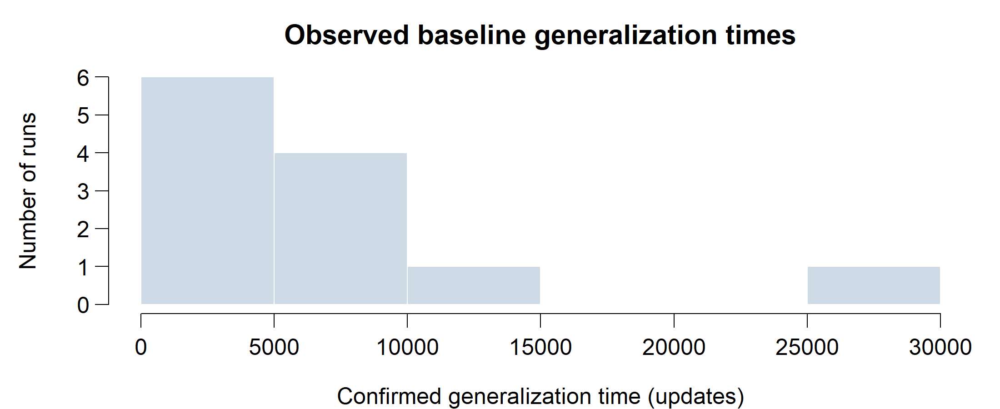
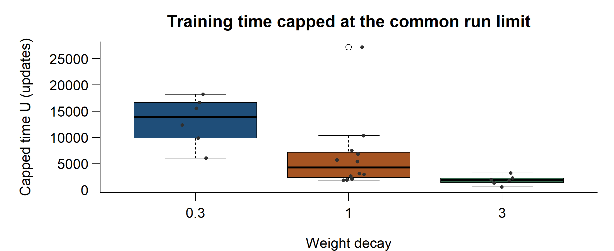
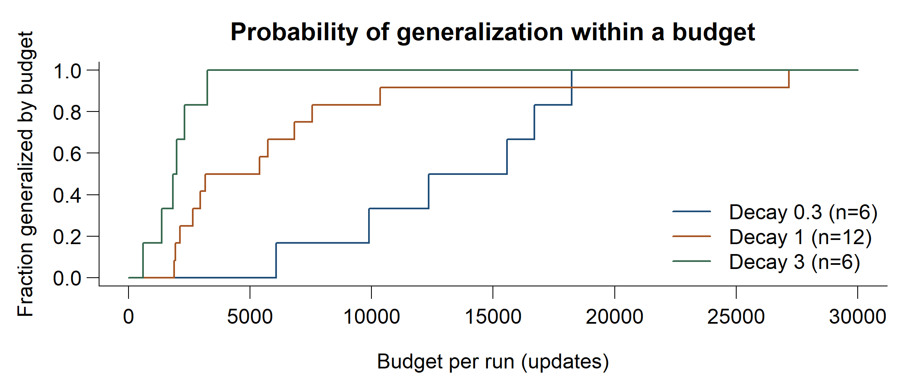
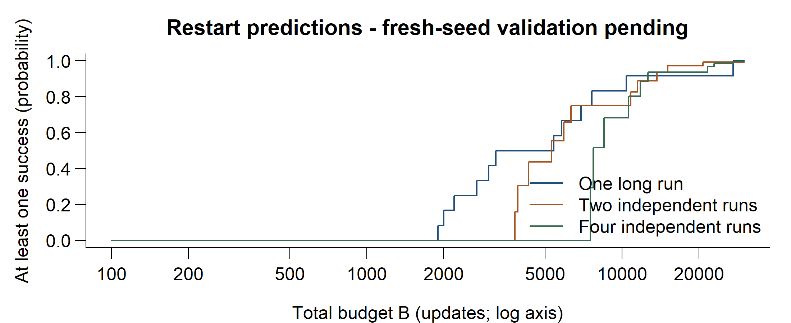

Grokking Under a Fixed Budget: One Long Run or Several Restarts?

**Review 1 - preliminary study** | Protocol established 13 October 2026 | BAMAT207 Probability and Statistics

1. Question and idea

A neural network may learn the examples it was trained on before it learns a rule that works on unseen examples. When that improvement is delayed, it is called grokking. We study how much the waiting time varies between independently initialized runs.

Our question is whether a fixed training budget is better spent on one long run or several shorter runs starting from fresh random weights. Grokking timing and restart strategies already have prior research. Their connection here is a proposed empirical contribution, not a claim that worldwide novelty has been established.

2. Experiment

We generate all 961 ordered pairs for y = (a + b) mod 31. At 60% training data, 576 pairs train the network and 385 unseen pairs measure generalization. The split seed is fixed. Initialization seeds are independent, so the random variable is conditional on this dataset split.

The network has one causal attention block, embedding size 64, four attention heads and a 128-unit feed-forward layer. There is no dropout or layer normalization. Full-batch AdamW uses learning rate 0.003 and betas (0.9, 0.98); weight decay is varied across 0.3, 1 and 3. Computation uses float32 with TF32 disabled.

Execution device: cpu. CPU runs use four threads each; independent main runs may execute in three separate processes. CUDA was unavailable to this execution environment. Update counts are the primary budget unit; runtime includes scheduling and logging overhead.

T is the checkpoint confirming three consecutive evaluations with unseen accuracy at least 95% and training accuracy at least 99%. Evaluations occur every 25 updates. Memorization time is recorded separately. Our operational delayed label requires T to be at least three times memorization time and at least 200 updates later. This label identifies a delay; it does not prove a particular mechanism.

Each main run is observed to C = 30,000 updates. If it has not generalized, T remains unknown and the run is retained as unfinished within this budget. U = min(T, C) is a separate, fully observed capped-time outcome. Pilot runs select the baseline and are excluded from main-study statistics.

Current evidence

**24 completed main-study runs**; 9 pilot runs; 0 failed and 0 paused main runs. Selected baseline: 60% data, weight decay 1. Review 1 results are exploratory; settings have small, unequal sample sizes.

---

3. From memorization to generalization

Figure 1. Early training window for main_f0.6_w1_s11105, selected near the baseline median event time. The complete 30,000-update trace is retained. Markers show confirmation checkpoints; later dips do not reset the first confirmed T, and relapse flags are retained.

Figure 2. Generalization times for the selected baseline: n = 12, events = 12, unfinished = 0. This histogram describes observed events only, not the unrestricted distribution of T.

A gap between the curves means the model performs well on training examples while still struggling with unseen pairs. Different event times across seeds show variability under otherwise fixed conditions. These observations do not identify the cause of the delay.

18 of 24 runs had at least one later unseen-accuracy dip below 95%. T therefore measures the first confirmed three-checkpoint event, not permanent accuracy. This distinction also applies to the restart success predictions.

---

4. Variability and budget reliability

Train fraction | Weight decay | Runs | Events | Delayed | Mean U | SD U

0.6 | 0.3 | 6 | 6 | 6 | 13,138 | 4,593

0.6 | 1 | 12 | 12 | 12 | 6,475 | 7,041

0.6 | 3 | 6 | 6 | 6 | 1,888 | 890

All time values are optimizer updates. A success is a confirmed threshold event by C. Means and standard deviations describe capped time U; unfinished runs are included at the cap. Conditional medians among successful runs are available in the CSV but must not be confused with an unrestricted median.

For the baseline, observed success probability is 12/12 = 100.0%, with exact 95% interval 73.5% to 100.0%. Mean U has a bootstrap 95% interval of 3,579 to 10,615 updates. The delayed count uses the operational timing criterion, not a mechanistic diagnosis.

Figure 3. Capped-time comparison at 60% data. Dots represent independent runs. Unfinished runs would remain at the cap; event flags distinguish them from events confirmed exactly at C.

Figure 4. Empirical probability F(t) of a confirmed generalization event by t, with all completed runs in each setting as the denominator. The curve is only supported up to C.

---

5. One long run or several restarts?

For k independent runs that each receive B/k updates, the probability of at least one success is 1 - [1 - F(B/k)]<super>k</super>. The formula follows from independence; the research question is whether splitting the budget helps in the measured setting.

Figure 5. Predicted policy success across total budgets, on a log update axis. Each curve uses the same baseline calibration runs. The intervals listed below at B = C transform exact 95% binomial intervals; policy estimates are correlated.

At B = 2,400, a reference budget rounded from the pilot median, predicted probabilities are k = 1: 25.0%; k = 2: 0.0%; k = 4: 0.0%. These are exploratory predictions, not validation results.

At the full observation budget B = C:

k = 1: 30,000 updates per run; predicted success 100.0% (interval 73.5% to 100.0%).

k = 2: 15,000 updates per run; predicted success 99.3% (interval 85.2% to 100.0%).

k = 4: 7,500 updates per run; predicted success 99.6% (interval 89.3% to 100.0%).

**These are predictions from the main-study runs, not observed restart-policy results.** Review 2 tests them on fresh seeds. Equal updates are compared within one setting; different training-data fractions have different costs per update. Runtime is recorded separately.

Equal predicted success at a generous cap does not imply equal performance at smaller budgets. The full-budget validation planned for Review 2 may therefore be inconclusive about differences near the transition.

---

6. Progress and Review 2

Review 1 implements the experiment protocol, training and checkpoint resumption, repeated-run export, fixed-budget policy runner, preliminary R analysis and this report. These components represent the planned approximately 65% implementation milestone; that percentage is not a measure of statistical evidence collected.

Review 2 expands to 20 seeds in each of six settings (120 main runs), then performs ten fresh-seed attempts for each of k = 1, 2 and 4. It adds censored distribution fitting, multiple regression and two-factor ANOVA. Small validation samples may leave policy differences inconclusive; that is an acceptable result.

Syllabus connection

Module 1: random variables, expectation, variance and independent events. Module 2: Bernoulli/binomial outcomes and candidate Exponential, Gamma and Weibull time models. Module 3: confidence intervals and hypothesis tests. Module 4: correlation and regression. Module 5: one-way and two-factor ANOVA. Methods with unsuitable assumptions or sparse counts are not forced onto the data.

Preliminary R output includes exact binomial confidence intervals, bootstrap capped-mean intervals, exploratory Welch comparisons with Holm adjustment, one-way ANOVA with permutation sensitivity, and correlation/regression. These outputs are supporting analyses rather than validated causal claims. Unrestricted mean time cannot be identified from the finite observation window.

References and reproducibility

Power et al. (2022), Grokking: Generalization Beyond Overfitting on Small Algorithmic Datasets. arxiv.org/abs/2201.02177. Truong et al. (2026), First-Passage Prediction of Grokking Delay. arxiv.org/abs/2605.18845. Streeter, Golovin and Smith (2007), Restart Schedules for Ensembles of Problem Instances. cs.cmu.edu/~dgolovin/papers/aaai07b.pdf. BAMAT207 official theory and embedded-lab syllabus, version 1, supplied archive.

Reproduce using the commands in README.md. Raw run configurations, traces and summary.csv are retained. R analysis uses only base R. This PDF and its graphs are generated from those outputs. Full inferential details are in inference.txt.