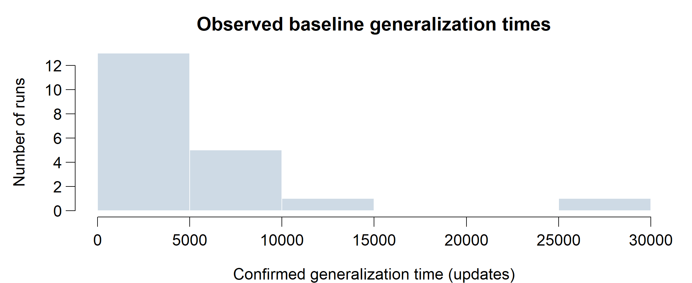
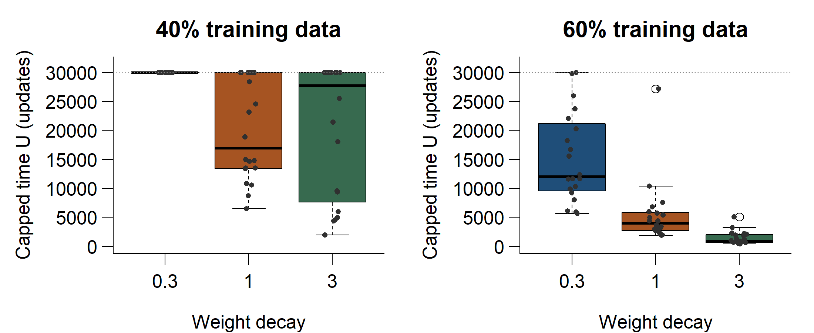
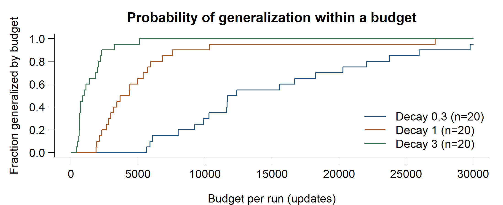
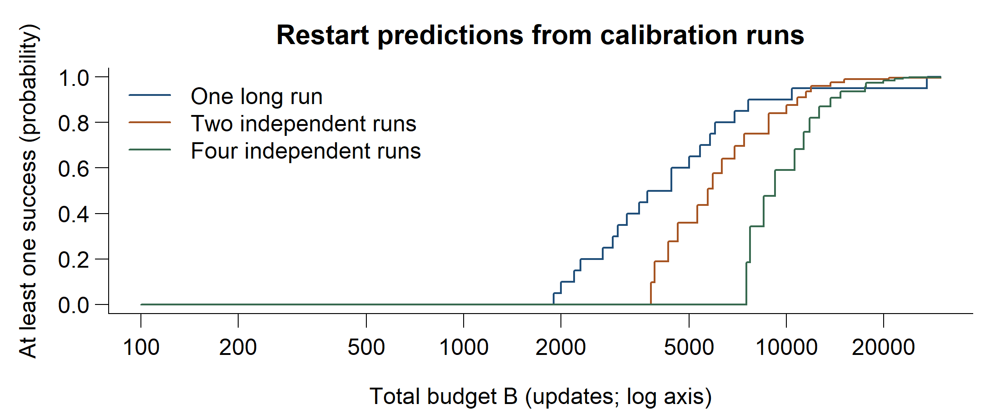
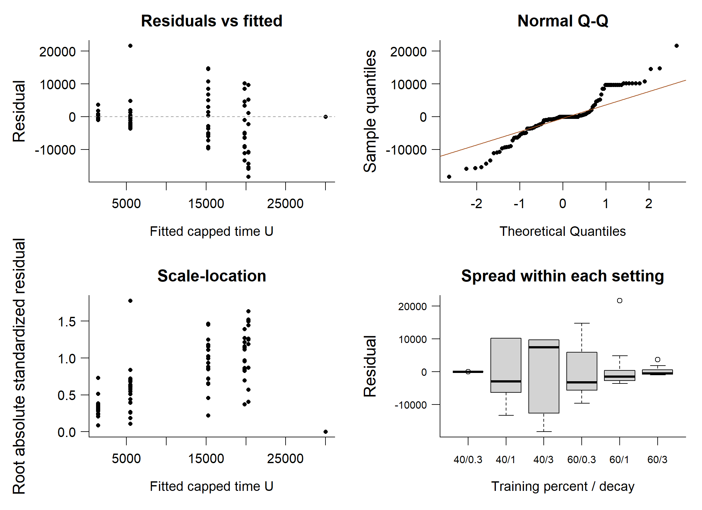
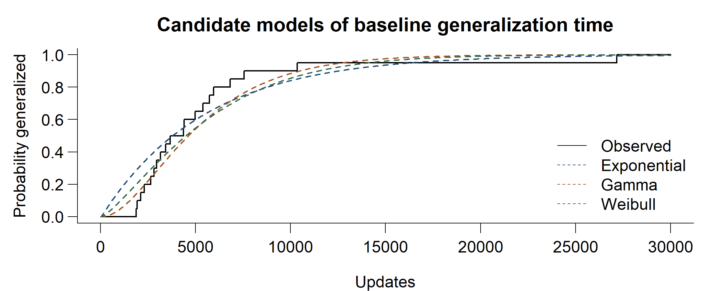
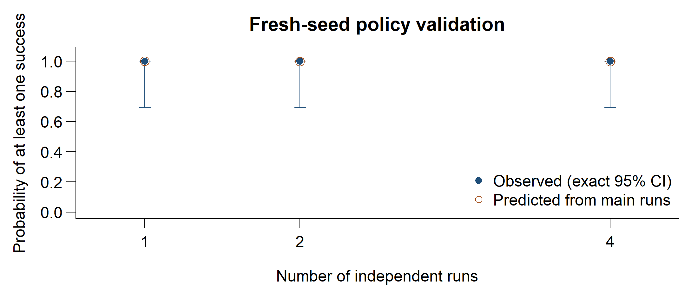

Grokking Under a Fixed Budget: One Long Run or Several Restarts?

**Review 2 - expanded study** | Protocol established 13 October 2026 | BAMAT207 Probability and Statistics

1. Question and idea

A neural network may learn the examples it was trained on before it learns a rule that works on unseen examples. When that improvement is delayed, it is called grokking. We study how much the waiting time varies between independently initialized runs.

Our question is whether a fixed training budget is better spent on one long run or several shorter runs starting from fresh random weights. Grokking timing and restart strategies already have prior research. Their connection here is a proposed empirical contribution, not a claim that worldwide novelty has been established.

2. Experiment

Modular addition wraps a sum back into 0-30: for example, (30 + 4) mod 31 = 3. One training update adjusts the network weights once using the entire training subset.

We generate all 961 ordered pairs for y = (a + b) mod 31. At 60% training data, 576 pairs train the network and 385 unseen pairs measure generalization. The expanded study also uses 40% data: 384 training and 577 unseen pairs. The split seed is fixed. Initialization seeds are independent, so the random variable is conditional on this dataset split.

The network has one causal attention block, embedding size 64, four attention heads and a 128-unit feed-forward layer. There is no dropout or layer normalization. Full-batch AdamW uses learning rate 0.003 and betas (0.9, 0.98); weight decay is varied across 0.3, 1 and 3. Computation uses float32 with TF32 disabled.

CPU execution uses four threads per run; three main processes overlap sequential validation. CUDA was unavailable. Budgets count logical updates along resumed trajectories; recovery can repeat unsaved work. Physical recovery overhead is not measured. Runtime includes CPU contention, excludes paused intervals and may omit lost partial-checkpoint work.

T is the checkpoint confirming three consecutive evaluations with unseen accuracy at least 95% and training accuracy at least 99%. Evaluations occur every 25 updates. Memorization time is recorded separately. Our operational delayed label requires T to be at least three times memorization time and at least 200 updates later. This label identifies a delay; it does not prove a particular mechanism.

Each main run is observed to C = 30,000 updates. If it has not generalized, T remains unknown and the run is retained as unfinished within this budget. U = min(T, C) is a separate, fully observed capped-time outcome. Pilot runs select the baseline and are excluded from main-study statistics.

Current evidence

**120 completed main-study runs**; 9 pilot runs; 0 failed and 0 paused main runs. Selected baseline: 60% data, weight decay 1. Each of six experimental cells contains 20 seeds. Fresh-seed policy validation is separate from calibration.

---

3. From memorization to generalization

Figure 1. Early training window for main_f0.6_w1_s11113, selected near the baseline median event time. The complete 30,000-update trace is retained. Markers show confirmation checkpoints; later dips do not reset the first confirmed T, and relapse flags are retained.

Figure 2. Generalization times for the selected baseline: n = 20, events = 20, unfinished = 0. This histogram describes observed events only, not the unrestricted distribution of T.

A gap between the curves means the model performs well on training examples while still struggling with unseen pairs. Different event times across seeds show variability under otherwise fixed conditions. These observations do not identify the cause of the delay.

62 of 83 generalized runs (120 total runs) had at least one later unseen-accuracy dip below 95%. T therefore measures the first confirmed three-checkpoint event, not permanent accuracy. This distinction also applies to the restart success predictions.

---

4. Variability and budget reliability

Train fraction | Weight decay | Runs | Events | Delayed | Mean U | SD U

0.4 | 0.3 | 20 | 0 | 0 | 30,000 | 0

0.6 | 0.3 | 20 | 19 | 19 | 15,235 | 7,786

0.4 | 1 | 20 | 14 | 14 | 19,822 | 8,562

0.6 | 1 | 20 | 20 | 20 | 5,481 | 5,548

0.4 | 3 | 20 | 10 | 10 | 20,282 | 11,447

0.6 | 3 | 20 | 20 | 18 | 1,430 | 1,164

All time values are optimizer updates. A success is a confirmed threshold event by C. Means and standard deviations describe capped time U; unfinished runs are included at the cap. Conditional medians among successful runs are available in the CSV but must not be confused with an unrestricted median.

A cell with no events has constant U = C. Zero SD of U does not mean zero variability of T; a degenerate bootstrap mean interval also misses uncertainty from events not seen in the sample.

For the baseline, observed success probability is 20/20 = 100.0%, with exact 95% interval 83.2% to 100.0%. Mean U has a bootstrap 95% interval of 3,596 to 8,224 updates. The delayed count uses the operational timing criterion, not a mechanistic diagnosis.

Figure 3. Capped-time comparison in both data fractions; 20 seeds per cell. Dots represent independent runs; unfinished runs remain at the cap.

Figure 4. Empirical F(t) at 60% data, with all completed runs in each setting as the denominator. The curve is supported only up to C.

---

5. One long run or several restarts?

For k independent runs that each receive B/k updates, the probability of at least one success is 1 - [1 - F(B/k)]<super>k</super>. The formula follows from independence; the research question is whether splitting the budget helps in the measured setting.

Figure 5. Predicted policy success across total budgets, on a log update axis. Each curve uses the same baseline calibration runs. The intervals listed below at B = C transform exact 95% binomial intervals; policy estimates are correlated.

At B = 2,400, a reference budget rounded from the pilot median, predicted probabilities are k = 1: 20.0%; k = 2: 0.0%; k = 4: 0.0%. These are exploratory predictions, not validation results.

At the full observation budget B = C:

k = 1: 30,000 updates per run; predicted success 100.0% (interval 83.2% to 100.0%).

k = 2: 15,000 updates per run; predicted success 99.8% (interval 93.8% to 100.0%).

k = 4: 7,500 updates per run; predicted success 99.9% (interval 97.9% to 100.0%).

**These are calibration predictions.** Page 7 compares them with independent fresh-seed validation. Equal updates are compared within one setting; different training-data fractions have different costs per update. Runtime is recorded separately.

A generous cap can make all policies highly successful while obscuring differences near the learning transition. Predictions at smaller budgets remain unvalidated.

---

6. Study scope and syllabus

The final study includes 120 main runs, nine pilot runs and 70 independent validation runs grouped into 30 fixed-budget attempts. Review 1 remains a separate frozen milestone. All runs retain configurations, evaluation traces and failure status; checkpoint resumption and outcomes reconstructed from traces are verified.

Across the six cells, 37 runs remain unfinished within the cap. Finite observation cannot identify unrestricted mean T. Findings are conditional on the fixed split, architecture and CPU numerical environment; these samples do not establish universal restart advice.

Syllabus connection

Module 1: random variables, expectation, variance and independent events. Module 2: Bernoulli/binomial outcomes and candidate Exponential, Gamma and Weibull time models. Module 3: confidence intervals and hypothesis tests. Module 4: correlation and regression. Module 5: one-way and two-factor ANOVA. The grokking application provides a contemporary topic for Module 6. Methods with unsuitable assumptions or sparse counts are not forced onto the data.

R output includes exact binomial confidence intervals, bootstrap capped-mean intervals, Welch comparisons with Holm adjustment, one-way ANOVA with permutation sensitivity, and correlation/regression. These are supporting statistical analyses; confidence intervals and sensitivity checks accompany the point estimates.

At 60% data, one-way ANOVA gives p = 3.685e-10; permutation sensitivity p = 0.000999. Pearson correlation of U with log decay is -0.715; Spearman correlation with decay is -0.866. These describe the measured settings, not an unrestricted timing law.

Two-factor residual Shapiro-Wilk p = 0.0001994. Small p values and the plotted diagnostics caution against relying only on ordinary normal-error tests. Permutation checks also require exchangeable errors.

Figure 6. Diagnostics for the two-factor model. Capping, skew and differing group spread can limit ordinary ANOVA inference; permutation sensitivity is reported alongside it.

---

7. Expanded statistical analysis

Two-factor ANOVA uses data fraction, categorical weight decay and their interaction. The permutation check uses reduced-model residual permutation for each term; it is a sensitivity check requiring exchangeable errors, and does not eliminate unequal-variance concerns.

Term | ANOVA p | Permutation p

Training fraction | 5.652e-23 | 0.000999

Weight decay | 7.085e-12 | 0.000999

Fraction x decay | 0.2894 | 0.3077

Multiple regression describes U using data fraction and log decay (R-squared = 0.630). Holding decay fixed, increasing training data from 40% to 60% changes fitted U by -15,986 updates. A one-unit increase in log decay changes it by -5,158 updates. Full coefficients are in the CSV. This linear description does not replace the interaction model.

Figure 7. Candidate families model T minus the 50-update confirmation lag, discretized to evaluations. Unfinished runs contribute survival probabilities. AIC ranks these candidates without establishing the true distribution.

Model | Converged | AIC

Exponential | TRUE | 257.15

Gamma | TRUE | 253.96

Weibull | TRUE | 256.85

Gamma has the lowest AIC among these candidates. Fitting uses only the selected baseline: 20 runs, 20 events and 0 unfinished runs. This small-sample ranking does not establish the true timing law.

---

8. Fresh-seed validation

Figure 8. Fresh-seed outcomes versus calibration predictions. Exact confidence intervals reflect only ten attempts per policy.

k | Successes / attempts | Observed (95% CI) | Mean runtime (s)

1 | 10 / 10 | 100% (69.2%-100.0%) | 244.6

2 | 10 / 10 | 100% (69.2%-100.0%) | 196.8

4 | 10 / 10 | 100% (69.2%-100.0%) | 188.4

Measured success: k = 1: 10/10; k = 2: 10/10; k = 4: 10/10. All policies succeeded in every attempt. This generous budget does not distinguish them; it does not establish equivalence.

The validation outcome measures at least one confirmed generalization event by the budget. All policies allocate equal total optimizer updates and run sequentially. These results are conditional on one modular-addition task, one architecture and one fixed dataset split; they do not generalize automatically to larger networks or other tasks.

Runtime is descriptive because CPU contention from main-study collection overlaps validation. The table is not a controlled wall-clock speed comparison.

References and reproducibility

Power et al. (2022), Grokking: Generalization Beyond Overfitting on Small Algorithmic Datasets. arxiv.org/abs/2201.02177. Truong et al. (2026), First-Passage Prediction of Grokking Delay. arxiv.org/abs/2605.18845. Streeter, Golovin and Smith (2007), Restart Schedules for Ensembles of Problem Instances. cs.cmu.edu/~dgolovin/papers/aaai07b.pdf. BAMAT207 official theory and embedded-lab syllabus, version 1, supplied archive.

Reproduce using the commands in README.md. Raw run configurations, traces and summary.csv are retained. R analysis uses only base R. This PDF and its graphs are generated from those outputs. Full inferential details are in inference.txt.